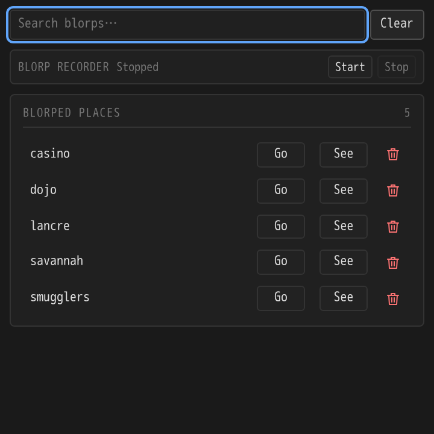

# Being's Discworld Blorp Recorder

A Mallard plugin listing saved blorp identifications in a dockable panel, styled like Being's Discworld XP Timers. Requires Mallard 0.25.0 or later.

## Install

Install `dist/beings-discworld-blorp-recorder-1.0.4.mallardx` using **Plugin manager → Install from file…**, then enable it for your Discworld world. For development, place the unpacked plugin in Mallard's dev plugins folder and reload plugins.

## Panel preview

This preview uses sample data in a standalone browser.

## Commands

| Command | Action |
| --- | --- |
| `/blorps_rec_start` | Start recording identifications in incoming MUD text. |
| `/blorps_rec_stop` | Stop recording. |
| `/blorps` | Print all saved places and recording status. |
| `/blorps_remove dojo` | Remove the exact identification `dojo`. |
| `/blorps_remove two words` | Remove an identification containing spaces; do not add quotes. |

The panel has equivalent Start Recording, Stop Recording, and per-place Go and See buttons and small red trash icons. Go sends `go <identification>` and See sends `see <identification>` directly to the MUD; the plugin requires send permission. Recording starts off on plugin load and stops on disconnect. Starting again adds to the existing list.

The search bar at the top instantly filters places by case-insensitive substring. Clear or manually emptying the field shows all places again. The search stays active when the list updates; the count shows matches / total while filtering. Recording controls occupy a compact strip.

After starting recording, run your usual `locate necklaces in pack`, look, inventory, or other commands. Every nonempty string between `("` and `")` in an incoming line is captured, regardless of item type. Multiple identifications on a single line are supported. The list is sorted and deduplicated by the exact, case-sensitive identification, so two items identified as `dojo` produce one place. Removing a place allows it to be recorded again if seen while recording is active. No item-type filter is applied, so any incoming text with that syntax can be captured during recording.

## Persistence

Each addition and removal is saved immediately through Mallard's persistent JSON `storage` API, under key `blorps`, separately for each world and plugin. The saved value has the form `{ "version": 1, "places": ["casino", "dojo"] }`. Failed writes are reported and leave the saved and displayed list unchanged.

Mallard's Lua sandbox removes `io` and `os` and documents `storage` as its persistence mechanism. This plugin therefore uses host-managed JSON storage rather than writing a user-selected text file. The UI does not claim a successful save when storage raises an error.

API reference used: [Mallard plugin development guide v0.25.0](https://mallard.vnsf.xyz/docs/mallard-plugin-dev-v0.25.0.html), especially persistent storage, world events, custom panels, theming, and local development.

## Verification

Run `rpmlua tests/recorder_test.lua` (Lua 5.3) from the plugin directory. The test exercises the entry point against mocked Mallard APIs, including the supplied examples, recording boundaries, unrestricted item types, multiple identifications, duplicate suppression, removal, reload persistence, panel messages, disconnect, invalid stored data, and storage write failures. Browser panel checks passed with a mocked Mallard bridge. Run `python3 tests/panel_test.py` in an environment with Playwright and Chromium installed to repeat the search, clear, recording status, button spacing, and Go/See/remove checks. An actual Mallard client smoke test is still needed for host integration.

## Build

Run `python3 scripts/build.py` with Python 3.11 or later. The build includes only the manifest, Lua source, panel assets, license, and README, with fixed ZIP timestamps for repeatable output. For marketplace CI, run `python3 scripts/build.py net.discworld.beings-discworld-blorp-recorder.mallardx`.

## Compatibility and testing

Validated against Mallard 0.27.0 (API 1.0). Run `python3 -m unittest discover -s tests -v` with the Lua 5.4 shared library installed. Run `python3 tests/panel_test.py` with Playwright and Chromium installed. Build with `python3 scripts/build.py`.
